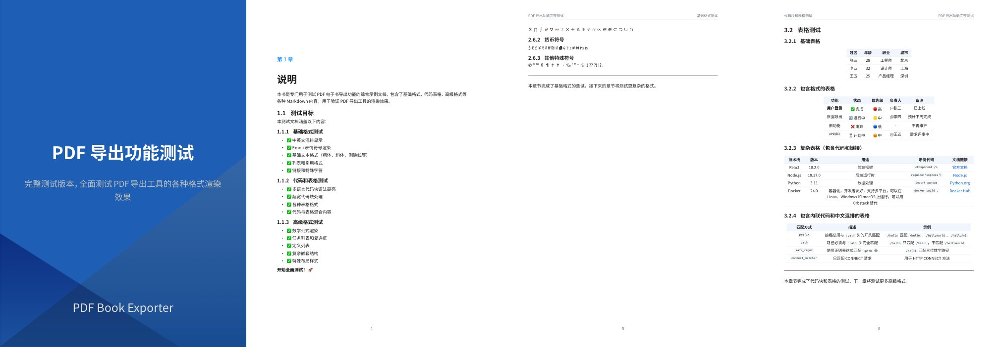

# pdf-book-exporter

Export a [Hugo](https://gohugo.io) book — a directory of page bundles with YAML
front matter — to a print-quality PDF.

The pipeline is deliberately short: **Markdown → Pandoc → Typst → PDF**. A
1,000-page book compiles in well under ten seconds. No LaTeX, no browser, no
image conversion step.

- Chapters ordered by `weight`, one level of nested sub-chapters, optional
  *parts* declared in the book's `_index.md` (or taken from the top-level
  sections), and an appendix part numbered `A`, `A.1`, `图 A-1`
- Figures, tables and footnotes numbered per chapter
- Hugo shortcodes mapped to print equivalents (`callout`, `table`, `figure`,
  `details`, `inline-codes`, `youtube`/`bilibili`); web-only ones removed
- SVG, PNG, JPEG, GIF and WebP images embedded natively; remote images
  downloaded once and cached under `~/.cache/pdf-book-exporter/`
- Cover and back-cover images (local file, URL, or discovered from the Hugo
  site), optional title overlay, colophon page, table of contents with page
  numbers, PDF outline, running headers
- Syntax-highlighted code blocks (Typst built-in), zebra tables that break
  across pages, callouts, task lists, footnotes, definition lists, math
- Chinese and English typography presets; colour emoji through system fonts



## Install

Requirements: Python ≥ 3.10, [Pandoc](https://pandoc.org) ≥ 3.1.7 and
[Typst](https://typst.app) ≥ 0.14.

```bash
brew install pandoc typst            # macOS
uv tool install git+https://github.com/rootsongjc/pdf-book-exporter
pdf-book-exporter --check
```

### Fonts

Each preset is a fallback chain. Before compiling, the exporter asks
`typst fonts` which families exist and passes only those to Typst, so a preset
family you do not have is skipped silently. You get a warning only when no
Chinese font is installed at all, or when a family you asked for by name is
missing.

| Preset | Chain |
|--------|-------|
| Body, Chinese (`zh-*`) | Noto Sans CJK SC → Source Han Sans SC → PingFang SC → Microsoft YaHei → Noto Sans |
| Body, other languages | Noto Sans → Helvetica Neue → Arial → Noto Sans CJK SC |
| Code | JetBrains Mono → Menlo → DejaVu Sans Mono → Consolas → Noto Sans Mono CJK SC |

Override with `--font` / `--monofont` or `book.font` / `book.monofont` in
front matter (comma-separated, in fallback order), and point Typst at extra
font directories with `--font-path`. On Debian/Ubuntu `fonts-noto-cjk` and
`fonts-noto-color-emoji` are enough; see [`.github/workflows/ci.yml`](.github/workflows/ci.yml).

## Usage

```bash
pdf-book-exporter content/zh/book/my-book                    # -> ./my-book-zh.pdf
pdf-book-exporter content/en/book/my-book -o dist/book.pdf
pdf-book-exporter content/zh/book/my-book --cover cover.jpg --backcover back.jpg
pdf-book-exporter content/zh/book/my-book --keep -v           # keep body.md / body.typ for debugging
```

| Flag | Purpose |
|------|---------|
| `-o, --output PATH` | Output path (default `./<book>-<lang>.pdf`) |
| `--cover`, `--backcover` | Image path or URL; overrides front matter and site lookup |
| `--no-cover` | Skip the cover even if one is found |
| `--font`, `--monofont` | Comma-separated font families, in fallback order |
| `--font-path DIR` | Extra font directory for Typst (repeatable) |
| `--include-drafts` | Include pages with `draft: true` |
| `--offline` | Never download; use cached remote images only |
| `--keep` | Keep the intermediate `body.md`, `body.typ`, `main.typ` (in a temp dir) |
| `--workdir DIR` | Write intermediate files to `DIR` (implies `--keep`) |
| `-v, --verbose` | Print the pandoc/typst commands and the cover source |
| `--check` | Verify that pandoc and typst are installed and recent enough |
| `--version` | Print the version |

When a build fails, the intermediate files are copied to a
`pdf-book-failed-*` temp directory and its path is printed.

## Book layout

```text
my-book/
├── _index.md             # book metadata: title, authors, parts, book: {...}
├── cover.jpg             # optional; picked up automatically (see Cover lookup)
├── back-cover.jpg
├── preface/
│   └── index.md          # chapter: title, weight, part_id, draft, export_pdf
├── chapter/
│   ├── _index.md         # chapter whose directory contains sub-chapters
│   └── section/
│       └── index.md      # sub-chapter (one level of nesting)
└── notes.md              # a loose .md file with front matter is a chapter too
```

Chapters are sorted by `weight` (then title). A page is skipped when it has
`draft: true` (unless `--include-drafts`), `export_pdf: false`, or
`status: offline` / `status: unpublished`. Directories named `images`, `img`,
`static`, `assets`, `drawio`, `image-caches` and anything starting with `.` or
`_` are not scanned for chapters.

Headings inside a page are re-levelled so the smallest one sits directly under
the chapter title; Hugo's "start at `##`" convention therefore needs no
special handling.

### Cover lookup

The first match wins:

1. `--cover` on the command line
2. `book.cover` (or top-level `cover`) in `_index.md` — a path relative to the
   book directory or an `http(s)` URL
3. `cover-<lang>.{webp,jpg,jpeg,png}` or `cover.*` inside the book directory
   (`<lang>` is the short code: `zh`, `en`)
4. In a Hugo site (a parent directory with `hugo.toml`/`config/` and
   `content/`): `static/images/book-covers/<slug>.*`, then the URL under
   `<slug>` in `data/<lang>/book_covers.yaml`
5. The cover shown in the book's `_index.md` body: the first image whose alt
   text or path contains `cover` or `封面`

Without a cover image a plain typeset title page is used instead. Generated
covers usually already carry the title, so the text overlay is off unless
`cover_overlay_enabled: true` is set. Back covers follow the same rules with
`backcover*` / `back-cover*` file names (no site lookup).

### `_index.md` front matter

Top-level Hugo fields (`title`, `authors`, `translators`, `description`, `date`,
`publisher`, `website`, `cover`, `language`) are used as-is. The optional `book:` block
overrides them and carries the PDF-only settings. Every key is optional; the
values below are the defaults unless noted.

```yaml
title: AI 原生基础设施
authors: [Jimmy Song]
translators: [译者甲，译者乙]            # optional; adds 译者 / Translator to the colophon
publisher: jimmysong.io
description: 一段用于版权页的简介
date: 2025-11-10                        # shown as 版本 / Edition on the colophon
parts:                                  # optional; chapters reference them via part_id
  - { id: part-i, title: "Part I · 定义", order: 1 }
  - { id: part-appendix, title: 附录，order: 2 }   # id or title matching appendix|附录 → A, B, ...
book:
  # metadata overrides
  title: 封面以外都用这个标题
  subtitle: 副标题                       # title page / cover overlay
  author: Jimmy Song                    # default: authors joined with ", "
  translator: Jimmy Song                # default: translators joined with ", "; a list also works
  language: zh-hans                     # default: inferred from the path (/zh/, /en/), else zh-hans
  website: https://jimmysong.io/book/ai-native-infra
  description: 覆盖顶层 description
  publisher: jimmysong.io
  date: 2025-11-10

  # cover images: path relative to the book directory, or a URL
  cover: cover.jpg
  backcover: back-cover.jpg

  # text overlay on the cover image (off by default)
  cover_overlay_enabled: false
  cover_title_text: 封面标题              # default: title
  cover_subtitle_text: 副标题             # default: subtitle
  cover_author_text: 作者                 # default: author
  cover_title_color: "#FFFFFF"
  cover_subtitle_color: "#FFFFFF"
  cover_author_color: "#FFFFFF"
  cover_title_font_size: 40             # pt
  cover_subtitle_font_size: 16
  cover_author_font_size: 20
  cover_title_position: center          # top | center | bottom (subtitle follows the title)
  cover_author_position: bottom

  # numbering and layout
  show_chapter_prefix: true             # 第 1 章 / Chapter 1 above chapter titles
  show_section_numbers: true            # 1.1, 1.2 ...
  show_toc_numbers: true
  show_figure_numbers: true             # 图 1-1 / Figure 1-1, 表 1-1 / Table 1-1
  toc_depth: 2
  sections_as_parts: false              # see Parts
  papersize: a4                         # a4 | us-letter
  font: "Noto Sans CJK SC, Noto Sans"   # default: language preset (see Fonts)
  monofont: "JetBrains Mono, Menlo"
```

Chapter pages (`index.md`) use `title`, `weight`, `part_id`, `draft`,
`export_pdf` and `status`; everything else in their front matter is ignored.

### Numbering

Figure, table and footnote numbers start again at 1 in every chapter. Figures
and tables carry the chapter number (`图 3-2`) as long as chapter numbers are
printed; with both `show_chapter_prefix` and `show_section_numbers` off they
are numbered `图 1`, `图 2`, … within the chapter.

### Parts

Parts come from one of two places:

- `parts` in `_index.md`, with each chapter naming its part through `part_id`
  (see above).
- `book.sections_as_parts: true`, for books whose directory layout already is
  part → chapter: every top-level section with child pages becomes a part and
  its pages become the chapters. The section's own `_index.md` body is printed
  on the part page as an introduction. Top-level pages without children stay
  chapters in front of the first part; `parts`/`part_id` are ignored.

Without this option a top-level section is one chapter and its pages are
sub-chapters, so numbering restarts per section rather than per page.

### Shortcode mapping

| Hugo | PDF |
|------|-----|
| `…` | Tinted callout block; kinds `note`, `info`, `tip`, `warning`, `caution`, `important` (`type=`/`title=` named args also accepted) |
| `…` | Table with caption, numbered 表 1-1; without `title` the plain table is kept |
| `` | Figure with caption (falls back to `title`, then `alt`) |
| `…` | Bold title + content, always expanded |
| `` | Fenced code block read from the file in the chapter directory |
| ``, `` | Clickable link to the video |
| `section-toc`, `cta`, `quiz`, `markmap`, `whimsical`, `podcast`, `marp-slide`, `online-slide` | Removed, including the content of paired ones |
| Any other paired shortcode | Tags removed, inner content kept |

Other print adjustments:

- `[text]()` and relative internal links become plain text;
  external links stay clickable.
- ` ```mermaid ` blocks are kept as plain-text code (Hugo renders them in the
  browser).
- Hugo image attributes such as `{width=800}` are dropped; images
  are scaled to fit the text block.
- `\( … \)`, `\[ … \]` and bare `\begin{align}` environments are normalised to
  `$…$` / `$$…$$` so Pandoc passes them to Typst's math mode.

## Example book

[`example/`](example/) is a small Hugo book that exercises everything above:
a loose preface, two parts, an appendix, a nested sub-chapter
(`advanced/layout/`), every supported shortcode (with a local SVG figure and an
`inline-codes` source file), a `draft: true` chapter that is skipped, and a
cover/back cover with the text overlay enabled. It doubles as the regression
fixture for the test-suite and CI builds it on every push.

```bash
uv run pdf-book-exporter example -o example.pdf
uv run pdf-book-exporter example -o example.pdf --include-drafts   # 7 chapters instead of 6
```

## Development

```bash
uv sync
uv run pytest
uv run pdf-book-exporter example -o example.pdf --keep -v
```

| File | Role |
|------|------|
| `src/pdf_book_exporter/book.py` | Walks the book directory, reads front matter, resolves covers |
| `src/pdf_book_exporter/markdown.py` | Hugo-specific rewriting (shortcodes, links, headings, math) before Pandoc |
| `src/pdf_book_exporter/templates/hugo.lua` | The only Pandoc filter: callout/table divs, task lists, `---`, mermaid |
| `src/pdf_book_exporter/templates/book.typ` | The whole visual design: fonts, colours, page furniture, callouts, figures, tables |
| `src/pdf_book_exporter/build.py` | Assembles `body.md` → `body.typ` → `main.typ` and runs pandoc/typst |
| `src/pdf_book_exporter/assets.py` | Copies local images, downloads and caches remote ones |

The previous Pandoc + LaTeX implementation is preserved on the `legacy/v1`
branch and the `v1.0.0` tag.

## License

Apache-2.0
