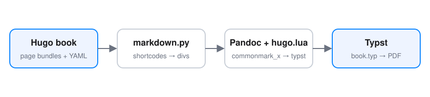

Hugo 短代码在浏览器里由模板渲染，PDF 里没有模板可用。导出器在交给 Pandoc 之前把它们改写成印刷等价物：有印刷意义的保留，只在网页上有意义的删除。

## Callout

`callout` 短代码变成带左侧色条的提示块，支持 `note`、`info`、`tip`、`warning`、`caution`、`important` 六种类型，第二个参数是可选标题。


这是一个 **note** 类型的提示块。提示块可以跨页断开，内部允许列表、代码和链接。



没有标题时只显示正文。`tip` 使用绿色。



`warning` 使用琥珀色，用于提醒读者可能造成损失的操作，例如：

```bash
rm -rf ./dist
```



`caution` 使用红色。请勿在生产环境执行。



`important` 使用紫色，用于必须阅读的说明。


## 带标题的表格

`table` 短代码的 `title` 变成表格图注，并按章自动编号为「表 4-1」：


| Hugo | PDF |
|------|-----|
| `callout` | 提示块 |
| `table` | 带图注的表格 |
| `figure` | 带图注的插图 |
| `details` | 加粗标题 + 正文 |
| `inline-codes` | 从文件读取的代码块 |
| `youtube` / `bilibili` | 视频链接 |


## 插图

`figure` 短代码和普通 Markdown 图片都会变成带编号图注的插图。SVG 直接嵌入，不经过位图转换，放大后依然清晰。



普通 Markdown 图片语法效果相同：



## 折叠块

`details` 在网页上是可折叠区域，印刷版展开显示，标题加粗：


LaTeX 的中文支持依赖 XeLaTeX 和一套很重的宏包，一本几百页的书要编译一分钟以上，出错时的信息也不友好。Typst 原生支持 Unicode、字体回退和 WebP/SVG 图片，编译只需几秒。


## 外部代码文件

`inline-codes` 从章节目录读取文件，生成带语言标记的代码块，可以用 `lineStart`/`lineEnd` 截取片段：



## 视频

视频无法印刷，替换为可点击的链接：





## 被删除的短代码

下面这些短代码只在网页上有意义，导出时连同内容一并删除，本段之后、下一节之前不应出现任何多余内容：




这段测验内容不应出现在 PDF 中。




## 未知短代码

未知的成对短代码会去掉标签、保留内部内容：


这一段来自一个导出器不认识的短代码，内容被原样保留。


## 内部链接

`relref` 和相对路径链接在 PDF 里无法跳转，只保留文字：[基础格式]()、[代码与表格](../code-and-tables/)。外部链接保持可点击：[Typst](https://typst.app)。
